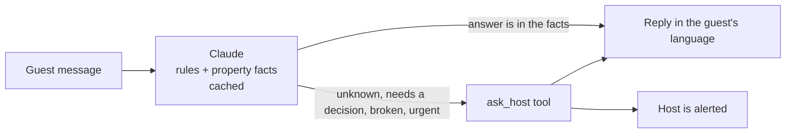

# Vacation Rental AI Concierge (Claude)

A 24/7 **AI guest assistant for Airbnb hosts, homestays and villas**. Guests ask in any language ("What's the wifi?", "Can I check out late?", "¿Dónde está la playa?") and Claude answers only from the facts you wrote about the property. Anything it can't answer or decide goes to the host with an `ask_host` tool call, instead of a made-up answer.

One Python file you run in the terminal, built with the official **Anthropic Python SDK**: streaming, tool use, and prompt caching.

> Want it as a real product for your guests or your host clients, with a guest page and QR code per property, stay codes that unlock door codes and wifi, a host inbox, Telegram and email alerts, reply and listing drafts, and a one-command AWS deploy? See the **[Vacation Rental AI Concierge Kit](https://kimhoang36.gumroad.com/l/vacation-rental-concierge-kit?utm_source=github&utm_medium=readme&utm_campaign=vacation-rental-ai-concierge)**.

## Run it

```bash
git clone https://github.com/shipready-ai/vacation-rental-ai-concierge
cd vacation-rental-ai-concierge
python -m venv .venv && source .venv/bin/activate
pip install -r requirements.txt
export ANTHROPIC_API_KEY=sk-ant-...
python concierge.py          # chats about the sample property in property.md
```

```
Guest: How do I get hot water?
Assistant: Switch on the red heater switch outside the bathroom about 10 minutes before your shower.

Guest: Can we check out at 2pm on Sunday?
Assistant: I'll ask Linh for you, since it depends on the next booking. You'll hear back soon.
  [host alerted, normal: Guest asks for late check-out at 14:00 on Sunday.]

Guest: 附近有海滩吗？
Assistant: 有的！美溪海滩步行约5分钟，沿着小巷往东走到尽头就到了。
```

## Use it for your own place

Copy `property.md`, write your own check-in steps, house rules, appliances, local tips and emergency numbers, and run `python concierge.py my-villa.md`. Plain text is enough: no Airbnb API or property management system needed.

## How it works



- **Grounded answers.** The system prompt says to answer only from the property facts and never invent prices, times or codes.
- **Decisions stay with the host.** Late check-out, refunds and discounts always go to `ask_host`, so the assistant never promises what the host didn't agree to.
- **Emergencies first.** Fire, injury or medical problems get the emergency numbers first, then an urgent alert.
- **Cheaper long chats.** The rules and facts are marked with `cache_control`, so every turn after the first reads them from the cache.

## Tests

```bash
pip install pytest
pytest -q      # uses a fake Claude client, no API key needed
```

## Lite version vs the full kit

| | This repo (free) | [Concierge Kit](https://kimhoang36.gumroad.com/l/vacation-rental-concierge-kit?utm_source=github&utm_medium=readme&utm_campaign=vacation-rental-ai-concierge) |
|---|---|---|
| Answers in the guest's language, from your facts | ✅ | ✅ |
| Hands off to the host with a tool | Prints to terminal | Host inbox + Telegram and email alerts |
| Guest web page per property, printable QR code | | ✅ |
| Stay codes: door code and wifi shared only during the booking | | ✅ |
| Host takes over the chat and hands it back | | ✅ |
| Drafts replies, review replies and listings in 6 languages | | ✅ |
| Many properties and host logins, CSV import | | ✅ |
| Cost per property, daily spend cap, rate limits | | ✅ |
| Docker, HTTPS, one-command AWS deploy, backups | | ✅ |

## More starter kits

Production-ready Claude projects with one-command AWS deploys: [all ShipReady AI kits](https://shipready-ai.github.io/?utm_source=github&utm_medium=readme&utm_campaign=vacation-rental-ai-concierge).

## License

MIT. See [LICENSE](LICENSE).
